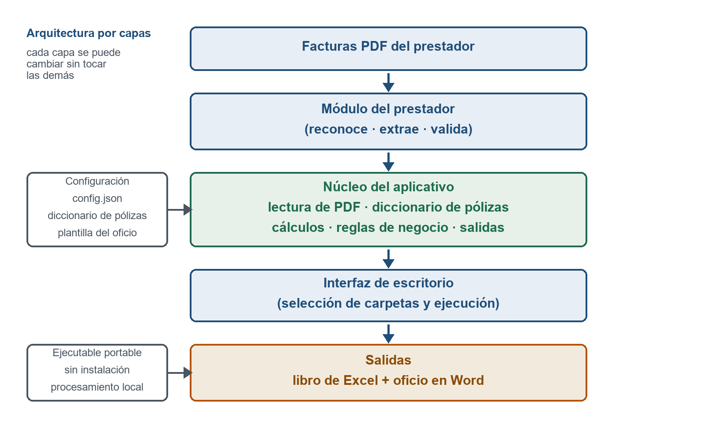

# Gestor de Facturas

Aplicación de escritorio que consolida las facturas electrónicas de servicios públicos (formato PDF) y
genera el libro de Excel con la tabla del informe y el oficio de remisión en Word.

Nació como parte de un plan de mejoramiento en la Secretaría de Educación de Soledad (Atlántico,
Colombia) para reemplazar la digitación manual de los conceptos de cada factura, que tomaba alrededor de
75 minutos al mes.

## Qué hace

1. Lee las facturas electrónicas de una carpeta.
2. Cruza cada factura con el diccionario de pólizas de las instituciones educativas.
3. Calcula los totales y aplica las validaciones (suma de conceptos, total a pagar, deuda, otros cobros).
4. Genera el libro de Excel con la tabla del informe, el detalle y las facturas sin coincidencia.
5. Genera el oficio de remisión en Word con la tabla insertada como imagen.
6. Arma un PDF único con el oficio seguido de la primera página de cada factura del periodo, con un
   marcador por factura.

## Capturas

**Pantalla principal.** Selección de la carpeta de facturas, del diccionario de pólizas y de la carpeta
de salida. Abajo, la consola en la que se informa cada paso de la ejecución.


**Arquitectura.** El núcleo lee y valida; cada prestador tiene su propio módulo y la configuración
externa permite cambiar textos y reglas sin tocar el código.



## Requisitos

- Python 3.11 o superior (para ejecutar desde el código).
- Microsoft Excel y Word no son necesarios para ejecutar, pero sí para revisar los archivos generados.
- Paquetes: ver `requirements.txt`.

## Instalación

```bash
pip install -r requirements.txt
```

## Uso

```bash
python app.py
```

O desde consola, indicando las carpetas:

```bash
python app.py --carpeta "ruta/a/las/facturas" --salida "ruta/de/salida"
```

## Configuración

Los datos institucionales (destinatarios, remitente, firmas, textos) y las reglas de cálculo están en
`config/config.json`. El repositorio incluye `config/config_ejemplo.json`, que debe copiarse a
`config/config.json` y completarse con los datos propios:

```bash
copy config\config_ejemplo.json config\config.json
```

## Datos que no se publican

Este repositorio **no incluye** información operativa de la entidad. Por confidencialidad se excluyeron:

- Las facturas de los prestadores (datos de consumo y financieros).
- El diccionario real de pólizas (se incluye `config/diccionario_ejemplo.xlsx` con datos ficticios).
- La plantilla del oficio con el encabezado de la entidad (`config/plantilla_remision.docx`).
- Las salidas, los respaldos y las bitácoras de cada ejecución.

Para usar la herramienta con datos reales hay que aportar el diccionario y la plantilla de la
organización. La plantilla debe ser un `.docx` con los párrafos que el programa reconoce: la línea de
ciudad y fecha, el bloque del destinatario (tratamiento, nombre, cargo, entidad), la línea `Ref.:`, el
párrafo del cuerpo que contiene «por valor de», el saludo `Cordialmente,`, el bloque del remitente y las
líneas `Proyectó:` y `Revisó:`.

## Estructura

```
app.py                punto de entrada y ejecución por consola
nucleo/               lectura de PDF, diccionario, cálculos, Excel, Word e interfaz
modulos/              un módulo por prestador (contrato en modulos/base.py)
config/               parámetros, diccionario de pólizas y plantilla del oficio
```

## Licencia

Este proyecto se distribuye bajo la licencia MIT (ver el archivo `LICENSE`): se puede usar, copiar,
modificar y distribuir conservando el aviso de autoría.

Los datos operativos de la entidad no forman parte de esta licencia porque no se publican en el
repositorio.
